<div align="center">

<picture>
  <source media="(prefers-color-scheme: dark)" srcset="docs/media/title-dark.png">
  
</picture>

### Prompt-to-Rig for Anime Characters with Garment Ownership, Held-Object Carriers, and Verified Live2D Export

<p><a href="https://wacv.thecvf.com/"></a><br><b>Describe a character. Make it move.</b></p>


[](https://codewayco.github.io/inkinesis-webpage/)
[](LICENSE)
[](docs/instructions/live2d_export.md)
<!-- When the paper is published, replace the Paper badge with the arXiv link. -->

[News](#news) · [See it move](#see-it-move) · [Contributions](#contributions) · [By the numbers](#by-the-numbers) · [Meet the characters](#meet-the-characters) · [Try the viewer](#try-the-viewer) · [Live2D export](#live2d-export) · [Method](#method) · [Installation](#installation) · [Documentation](#documentation) · [Citation](#citation)

</div>

<!-- GitHub renders a bare attachment URL as an inline video player (a 1600x1000, 30 fps copy under the 10 MB limit). The full-resolution file is docs/media/showcase.mp4, linked below. -->

https://github.com/user-attachments/assets/59a07596-c1aa-4210-a329-8bc3e9509ae1

[**Watch the showcase · 1.5 min**](docs/media/showcase.mp4) · [Open the local video player](docs/media/showcase.html)

*Neutral rigs above, the same rigs moving below: actual Inkinesis playback, not generated video.*

## News

- **November 2026:** Inkinesis is accepted at **WACV 2027**. Version 1.0 adds the method described in the paper: anatomical garment ownership, per-chain hinge profiles for the two-joint limbs, rigid wrist carriers for held objects, and Live2D export for Cubism 5.0, together with 30 ready-to-try example characters from the 94-character evaluation.

## See it move

<table>
<tr>
<td width="67%">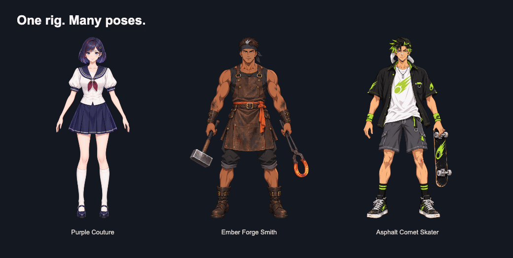</td>
<td width="33%">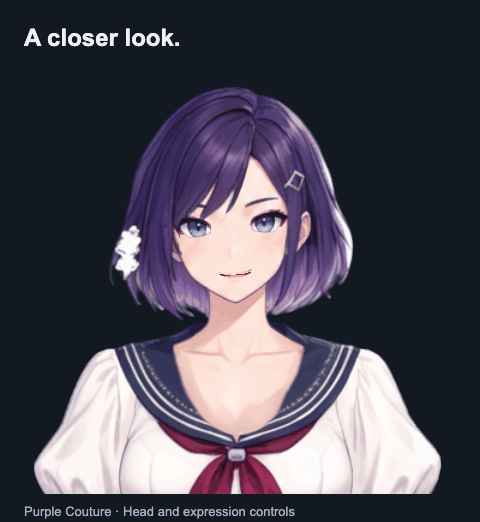</td>
</tr>
</table>

Inkinesis turns a text prompt into a layered, animated 2D rig. Explore the result in your browser, save the complete asset, and export it for **Inochi2D** or **Live2D**.

| Create | Animate | Take it with you |
| --- | --- | --- |
| Start with a description of your character. | Preview head movement, expressions, and supported limb motion. | Save the complete run and export `.inp` or a Live2D package. |

## Contributions

**Garment ownership.** Each garment pixel is assigned to the limb that carries it: sleeves follow the arms, trouser tubes follow the legs, the seat blends both legs, and everything else stays with the torso. Against nearest-bone assignment, torso drift falls from 11.77% to 0.28% on 64 measurable characters.

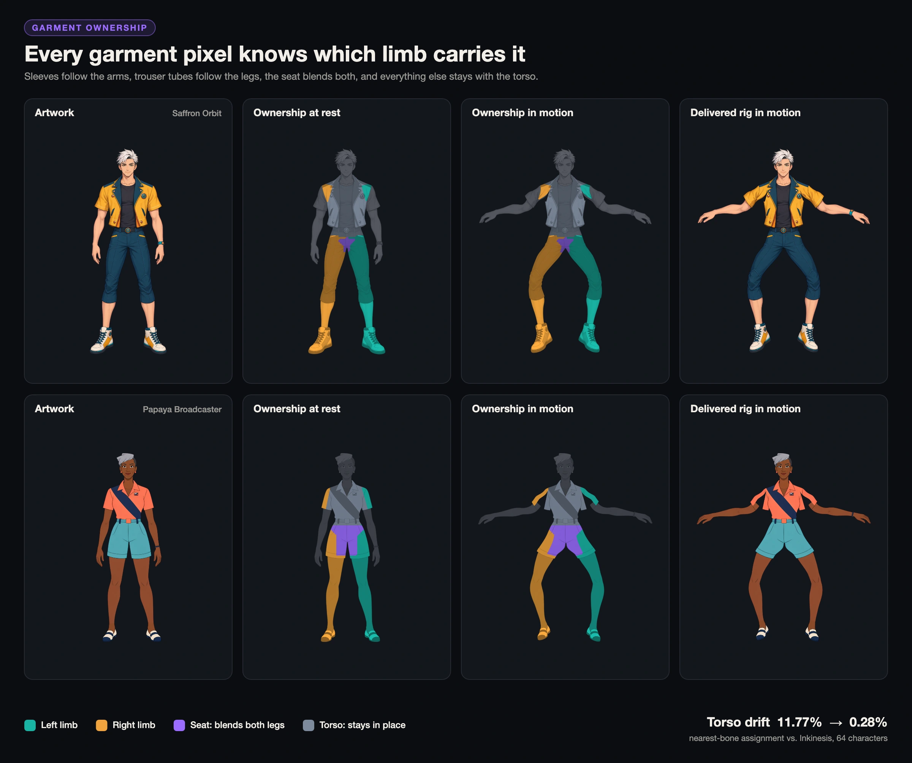

**Held-object carriers.** Every object touching a hand rides a rigid carrier that follows that wrist. Removing the carriers raises new hand–object contact loss from 2.86% to 95.71% at the same arm trajectories.

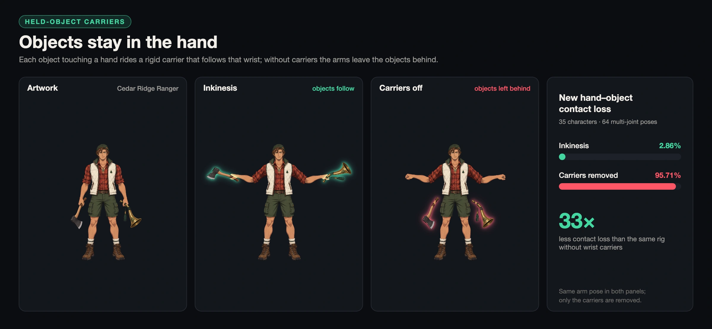

**Verified Live2D export.** Every rig is delivered as an Inochi2D puppet and a Live2D MOC3. All 94 exports reproduce the source geometry within 0.005 px under the official Cubism Core across the 164-pose protocol.

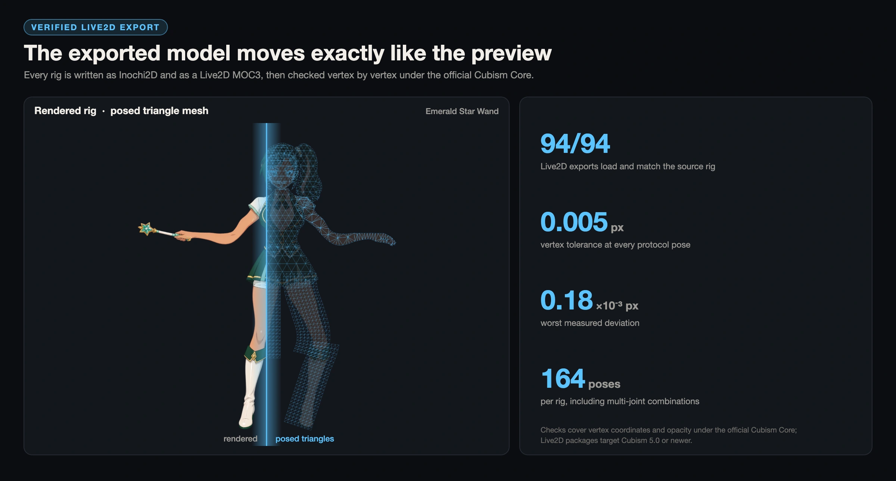

## By the numbers

| Result | What it measures |
| --- | --- |
| **230–237 seconds** | saved illustration to first export across four recorded runs; remote H100 80GB decomposition, with local preparation and export |
| **94 evaluated characters** | the full paper evaluation; 30 of them ship as ready-to-try examples, each with an Inochi2D `.inp` and a Live2D package |
| **94 / 94** | Live2D exports pass the recorded official Cubism Core geometry checks at ≤0.005 px |
| **Up to 780 limb poses per rig** | authored keys and half-grid samples cover each enabled limb; the count varies with available controls |

Timings include decomposition inference and transfers, but exclude image generation, later revisions and repeated validation. The recorded Core checks concern geometric export fidelity, not visual quality or universal support. The [catalog audit](docs/media/catalog-validation.json) matches the 30 shipped Live2D packages to their saved Core reports.

## Meet the characters

These examples were built from AI-generated illustrations using Inkinesis and saved as reusable rigs so you can try the viewer without a GPU or API key. You can also describe your own character; supported movements depend on the design and the results of layer and motion checks.

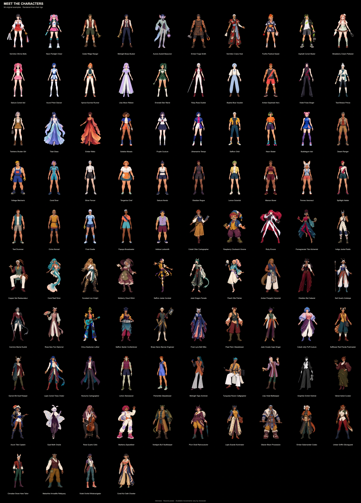

*Neutral previews of all 94 characters evaluated in the paper. You can try 30 of them in the viewer with **Pick an Avatar**: the characters featured in the paper and those that move most reliably. The first Download installs both formats locally. To make your own, see [Installation](#installation).*

## Try the viewer

With **Node.js 22+**, you can open the interface before configuring generation:

```sh
npm ci
npm run dev
```

The browser opens at **http://localhost:5200/**. Use **Pick an Avatar** to try the 30 example characters, or **Choose File** to open a compatible Inkinesis `.inp`. Playing a prepared rig needs no GPU or API key.

Newly generated rigs use the full method by default: adaptive limb sampling, ownership-aware clothing motion, held-object attachments, and geometry-gated arm and knee refinement run automatically, with no feature flags to enable. Motion limits remain source-dependent; two-hand objects and ambiguous contacts may be restricted. The 94-character evaluation deliberately keeps difficult cases and known failures, such as the static helmet of Starberry Spacefarer; those appear in the gallery above and in the paper, while the viewer ships the 30 examples.

Select an example and press **Download**. The app installs its rig files in `example-avatars/<id>/`, verifies the download, and opens the character for animation. The button changes to **Downloaded**, and future sessions reuse those local files.

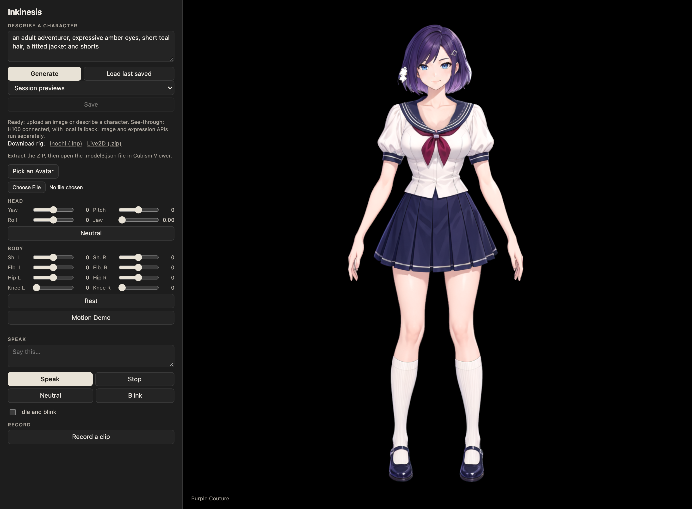

*Inspect the rig, try its controls, and save only the results you want to keep. To generate new characters, complete the [installation](#installation).*

## Live2D export

Take the character beyond the browser. Every character also exports as a Live2D package that runs in **Live2D-compatible applications**.

Use **Live2D (.zip)** in the viewer to download a model package. See the [export guide](docs/instructions/live2d_export.md) for its contents and requirements.

**New Live2D exports require Cubism 5.0 or newer**, including a compatible Viewer/Editor and runtime. Channel blend shapes are enabled by default; the new export path does not target Cubism 4.2.

<a id="how-it-works"></a>

## Method

**A pipeline built around the character, with explicit checks at every boundary.**

1. **Describe.** Start with a prompt; an image model draws the character for rigging.
2. **Separate & understand.** See-through decomposes the appearance. Inkinesis checks the proposed landmarks against those layers and prepares registered facial variants.
3. **Give the pixels a joint.** Compose two-joint limbs with the psd2live face rig. Missing joints can be proposed from prepared limb alpha and garment/footwear bounds. Geometry, attachment and simultaneous-leg checks decide which proposals move; garments follow their owning limbs.
4. **Export & verify.** Deliver an Inochi2D rig and a Live2D package. Compare the control behavior with the browser evaluator, native runtime and official Cubism Core.

<table>
<tr>
<td width="33%" align="center" valign="top"><strong>01 · Illustration</strong><br><sub>INPUT</sub><br>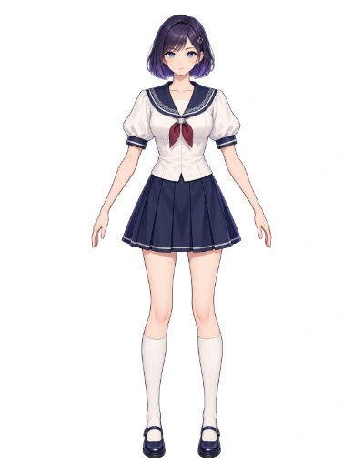<br><sub>Drawn from the prompt.</sub></td>
<td width="33%" align="center" valign="top"><strong>02 · Semantic layers</strong><br><sub>REUSED</sub><br>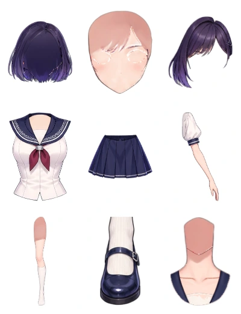<br><sub>See-through decomposition.</sub></td>
<td width="33%" align="center" valign="top"><strong>02 · Expressions</strong><br><sub>OURS</sub><br>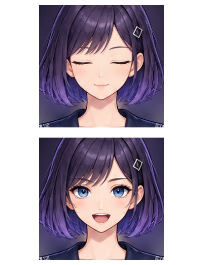<br><sub>Registered eye and mouth edits.</sub></td>
</tr>
<tr>
<td width="33%" align="center" valign="top"><strong>02 · Verified joints</strong><br><sub>VERIFIED</sub><br>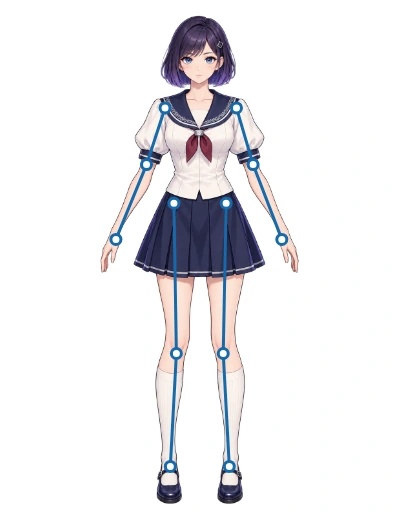<br><sub>VLM proposes; Inkinesis verifies.</sub></td>
<td width="33%" align="center" valign="top"><strong>03 · Composed rig</strong><br><sub>OURS</sub><br>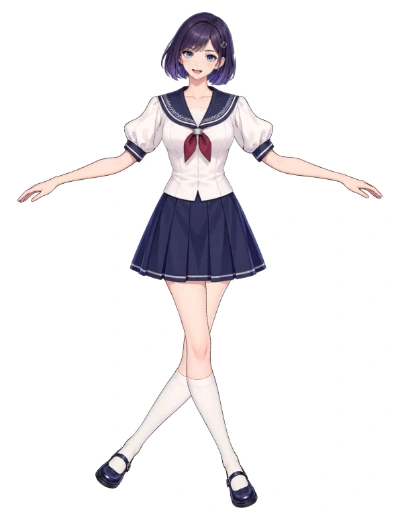<br><sub>Limbs, face and garment ownership.</sub></td>
<td width="33%" align="center" valign="top"><strong>04 · Live2D export</strong><br><sub>VERIFICATION</sub><br>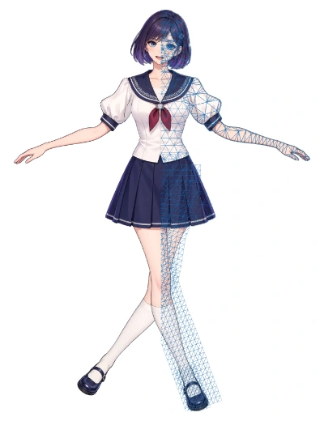<br><sub>Official Core and deformed mesh.</sub></td>
</tr>
</table>

[Open the complete pipeline figure](docs/media/pipeline.webp). The panel numbers match the four steps above. Purple Couture’s export view uses the same controls as the composed rig; its wireframe shows actual posed Core triangles, including overlapping parts and transparent texture margins.

**Reused components:** See-through supplies semantic layers, psd2live supplies the facial source rig, and a VLM proposes joints. **Inkinesis contributions:** landmark verification against the decomposition, registered expression preparation, anatomical garment ownership, continuous two-joint limb composition and a shared facial pitch field. **Export evidence:** Purple Couture’s saved report covers 379 test poses with 0 Core-aware drawable mismatches; the strict comparison reports 1 mismatch due to runtime sampling. See [validation details](docs/instructions/live2d_export.md#near-key-runtime-differences) and [figure provenance](docs/media/method/provenance.json).

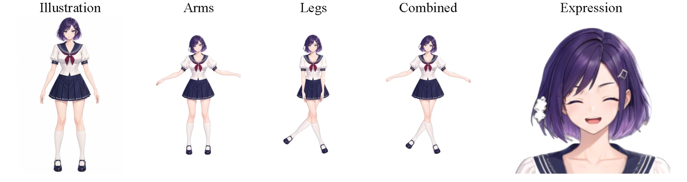

*From one illustration to a rig with arm, leg and expression controls. Every panel is a render of the generated asset.*

**The drawing sets the limits.** A held prop, hidden knee or long garment can constrain motion. Each arm, leg, head axis, blink and mouth control is checked independently; unsupported regions stay still or receive a reduced range. Clothing follows its assigned body regions, and hidden anatomy is not assumed to be available. The UI explains available and reduced controls in **Movement details**. Generated rigs still need visual review.

## What you get

Each run, saved from the UI or written by the CLI, is a self-contained folder:

```text
outputs/<run-id>/
├── character.inp        Inochi2D rig: meshes, textures, head, expression and limb parameters
├── layers.psd           semantic layers as decomposed
├── assets/character.psd prepared layers with registered expression patches
├── analysis.json        joint landmarks, confidence and per-region motion assessment
├── report.json          stages, validation results, file inventory and review status
├── demo.gif             animated preview
├── frames/              native-runtime evidence renders
└── live2d-<run-id>/model/
    ├── Character.moc3          Live2D runtime model
    ├── Character.model3.json   manifest referencing textures and parameters
    ├── Character.cdi3.json     parameter display names
    ├── Character.cmo3          reconstructed Cubism Editor project
    └── *.png                   texture atlases
```

Prepared example downloads contain the same `character.inp` and a `Live2D.zip` with the `model/` folder above, without the `.cmo3` editor project.

## Installation

For **generating new rigs**, use macOS on Apple Silicon or Linux with NVIDIA CUDA. Choose local inference or the optional remote H100 bridge; an H100 is not required. For prepared rigs, use the [viewer quick start](#try-the-viewer).

### 1. Install system prerequisites

- Node.js **22+**, npm, and Git.
- Python **3.14** for preparation; Python **3.12** for local GPU inference.
- JDK **21** and a D compiler with DUB for the native verifier.
- Optional: eSpeak NG for speech and lip-sync previews.

Set `JAVA_HOME` to JDK 21, or configure `RIG_JAVA_HOME` in `.env`.

### 2. Install dependencies

Run from the repository root:

```sh
python3.14 -m venv .venv
.venv/bin/python -m pip install --upgrade pip
.venv/bin/python -m pip install -r requirements.txt
npm ci
```

### 3. Configure providers

```sh
cp .env.example .env
```

Fill in your keys and model IDs in `.env`:

```dotenv
ANTHROPIC_API_KEY=your-analysis-key
OPENAI_API_KEY=your-image-key
RIG_ANALYSIS_MODEL=your-available-anthropic-vision-model-id
IMAGE_MODEL=your-available-image-generation-and-edit-model-id
```

Both providers are used for generation from text or an image, including expression edits. Use model IDs enabled for your accounts. API calls incur provider charges; keep `.env` private.

### 4. Prepare the engine and choose your GPU

All generation backends need the local engine and verifier:

```sh
mkdir -p .cache/rig
git clone https://github.com/tsunehimatoi/psd2live.git .cache/rig/psd2live
git -C .cache/rig/psd2live checkout 5526f2e16b57e5f83d34f33730d6fa26d8bc8695
(cd .cache/rig/psd2live && bash ./gradlew --no-daemon classes)
npm run prepare:inochi
```

Expand **one** backend below and follow its steps. Local weights require about **12.5 GiB of disk space**; inference requires a compatible GPU with BF16 support. CPU-only See-through inference is not implemented.

<details>
<summary><strong>NVIDIA CUDA · local inference on Linux</strong></summary>

Use a driver compatible with the CUDA 12.8 wheels:

```sh
python3.12 -m venv .venv-gen
.venv-gen/bin/python -m pip install --upgrade pip
.venv-gen/bin/python -m pip install torch==2.8.0 torchvision==0.23.0 --index-url https://download.pytorch.org/whl/cu128
.venv-gen/bin/python -m pip install -r requirements-gpu.txt
git clone https://github.com/shitagaki-lab/see-through.git .cache/rig/see-through
git -C .cache/rig/see-through checkout 7f139bb25c46a0c8ac720d95ddab185fcda5451c
.venv-gen/bin/python tools/generate/downloadModels.py --output .cache/rig/models
```

Add to `.env`:

```dotenv
RIG_GPU_BACKEND=local
RIG_DEVICE=cuda
```

</details>

<details>
<summary><strong>Apple Silicon MPS · local inference on macOS</strong></summary>

```sh
python3.12 -m venv .venv-gen
.venv-gen/bin/python -m pip install --upgrade pip
.venv-gen/bin/python -m pip install torch==2.8.0 torchvision==0.23.0
.venv-gen/bin/python -m pip install -r requirements-gpu.txt
git clone https://github.com/shitagaki-lab/see-through.git .cache/rig/see-through
git -C .cache/rig/see-through checkout 7f139bb25c46a0c8ac720d95ddab185fcda5451c
.venv-gen/bin/python tools/generate/downloadModels.py --output .cache/rig/models
```

Add to `.env`:

```dotenv
RIG_GPU_BACKEND=local
RIG_DEVICE=mps
```

The MPS runner requires BF16 support. The dependency pins originate from the CUDA environment; this exact fresh combination has not been validated on every macOS version. See [device troubleshooting](docs/instructions/setup_troubleshooting.md#gpu-and-memory).

</details>

<details>
<summary><strong>Remote H100 · See-through over JupyterHub</strong></summary>

Follow [remote setup](docs/instructions/remote_gpu.md) to install See-through and its weights on your H100 server, configure the local path mapping, and start the bridge. Set `RIG_GPU_BACKEND=h100` in your local `.env`.

H100-only operation skips the local `.venv-gen` environment and local See-through weights. Local preparation, Java, and the verifier above remain required. For `h100-first` fallback, also configure one of the local backends.

</details>

Third-party components and weights retain their own terms. Read [NOTICE](NOTICE), including the unresolved See-through depth-weight license, before redistribution.

### 5. Check setup and open the UI

```sh
npm run check:setup
npm run dev
```

Open **http://localhost:5200/**, describe a character and press **Generate**. Restart the dev server after changing `.env`. If setup or a run fails, follow [setup troubleshooting](docs/instructions/setup_troubleshooting.md).

## Generating from the command line

```sh
npm run inkinesis -- --prompt "An adult adventurer with teal hair and a fitted jacket" --out outputs/my-character
npm run inkinesis -- --prompt "An adult adventurer with teal hair and a fitted jacket" --out outputs/my-character --resume
npm run inkinesis -- --prompt "An adult adventurer with teal hair and a fitted jacket" --live2d
npm run export:live2d -- outputs/my-character/character.inp outputs/my-live2d Character
```

CLI runs write directly to an output directory. UI runs stay temporary until you press **Save**; see [saving and downloads](docs/instructions/image_to_rig.md#saving-and-downloads) for where files go and how the Live2D package is prepared.

## Limits

- **One front-facing, full-body character** per prompt. Several characters or unsuitable face views are refused.
- **Separated limbs and visible joints** give the best rigs. Hidden joints can be estimated from prepared layers, but a chain stays fixed when the source support or motion checks fail. Existing moving control domains are retained when selecting a fallback proposal; the checks cover sampled poses, not every possible image artifact.
- **Clothing, facial hair and accessories are preserved**, not simplified to make rigging easier.
- **The mouth is a measured patch**, not separately articulated teeth and tongue; seams can show at extreme poses or on unusual designs.
- **A successful export still needs visual review.** `success` means the rig was exported and passed native validation. Geometry and runtime checks do not establish texture quality or natural anatomy.

## Development

```sh
npm run typecheck
npm run lint
npm test
npm run test:python
npm run build
npx playwright install chromium
# In another terminal, start npm run dev; then:
npm run verify:ui
npm run verify:upload
npm run verify:example-download
# Optional: after installing all 30 example avatars locally:
npm run verify:examples
node --import tsx tools/verify/uiSaveSmoke.ts
```

Portable tests use authored synthetic geometry. Optional native parity tests require separately supplied private assets via `RIG_TEST_ASSET_DIR`; they are explicitly skipped when those assets are absent. UI smoke tests make no model calls. `npm run build` produces `dist/player`; static hosting supports uploaded-rig preview, while example installation, generation, and export preparation require the local dev service. This service is for a trusted local machine, not an authenticated multi-user server.

## Documentation

- [Setup troubleshooting](docs/instructions/setup_troubleshooting.md)
- [Example avatar distribution](docs/instructions/avatar_library.md)
- [Pipeline stages, saving and downloads](docs/instructions/image_to_rig.md)
- [Preparation and motion](docs/instructions/independent_preparation.md)
- [Head attachments and source-visible coverage](docs/instructions/head_and_coverage.md)
- [Live2D export](docs/instructions/live2d_export.md)
- [Remote H100 setup](docs/instructions/remote_gpu.md)
- [Optional quality checks](docs/instructions/quality_control.md)
- [Release scope](docs/RELEASE.md)

## Acknowledgements

Inkinesis stands on work we are grateful for:

- **[See-through](https://github.com/shitagaki-lab/see-through)** for semantic layer and depth decomposition of character illustrations.
- **[psd2live](https://github.com/tsunehimatoi/psd2live)** for facial keyforms and the Live2D serialization path.
- **[Inochi2D](https://github.com/Inochi2D/inochi2d)** for the open puppet format and the native runtime used for verification.
- **[Live2D Cubism SDK](https://www.live2d.com/en/sdk/about/)** for the official Core used in export validation.
- **[eSpeak NG](https://github.com/espeak-ng/espeak-ng)** for phoneme timing behind the speech preview.

## Citation

If you use Inkinesis in your work, please cite:

```bibtex
@inproceedings{celiktenyildiz2027inkinesis,
  title     = {Inkinesis: Prompt-to-Rig for Anime Characters with Garment Ownership, Held-Object Carriers, and Verified Live2D Export},
  author    = {Çeliktenyıldız, Mehmet Salih},
  booktitle = {Proceedings of the IEEE/CVF Winter Conference on Applications of Computer Vision (WACV) Workshops},
  year      = {2027}
}
```

## Licensing

Core project code is Apache-2.0. The psd2live adapters have GPL-3.0-only headers and run in a separate process. External software, model weights, SDKs, and user artwork retain their own terms. See [NOTICE](NOTICE) and [asset licensing](LICENSE-ASSETS.md). To cite this project, see [Citation](#citation) or [CITATION.cff](CITATION.cff).
